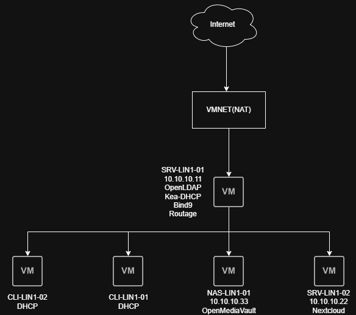

# Documentation Technique - Infrastructure LIN1

**Auteur :** Thibault Le Normand  
**Projet :** LIN1 - Infrastructure réseau basée sur des solutions libres

---

# 1. Présentation du projet

L'objectif du projet est de mettre en place une infrastructure réseau complète permettant la gestion centralisée des utilisateurs, du stockage et des services réseau.

L'environnement déployé repose sur trois serveurs Linux :

| Machine | Adresse IP | Fonction |
|----------|----------|----------|
| SRV-LIN1-01 | 10.10.10.11 | DNS, DHCP, LDAP, LAM, Routeur NAT |
| SRV-LIN1-02 | 10.10.10.22 | Nextcloud |
| NAS-LIN1-01 | 10.10.10.33 | OpenMediaVault, RAID1, NFS |

Des postes clients Linux et Windows permettent de valider le fonctionnement de l'infrastructure.

---

# 2. Architecture réseau

L'infrastructure est organisée autour d'un réseau local :

```text
10.10.10.0/24
```


SRV-LIN1-01 joue le rôle de passerelle Internet et de serveur principal.


---

# 3. SRV-LIN1-01

## Présentation

SRV-LIN1-01 est le cœur de l'infrastructure.

Il fournit les services suivants :

- DNS (Bind9)
- DHCP (Kea DHCP)
- LDAP (OpenLDAP)
- LDAP Account Manager (LAM)
- Routage NAT

---

## Configuration matérielle

| Ressource | Valeur |
|------------|------------|
| RAM | 1 Go |
| Disque | 10 Go |
| Interfaces réseau | 2 |
| Système d'exploitation | Debian 13 |

---

## Configuration réseau

### Interface WAN

```text
ens33
DHCP
```

Cette interface assure l'accès à Internet.

### Interface LAN

```text
ens37
10.10.10.11/24
```

Cette interface dessert l'infrastructure interne.

### Validation

```bash
ip a
ip route
```

---

# Routage et NAT

## Objectif

Permettre aux postes du réseau local d'accéder à Internet via SRV-LIN1-01.

## Activation du routage IPv4

```bash
echo "net.ipv4.ip_forward=1" > /etc/sysctl.d/99-routing.conf
sysctl --system
```

## Configuration du NAT

```bash
iptables -t nat -A POSTROUTING -o ens33 -j MASQUERADE
```

Cette règle remplace l'adresse source des postes du LAN par l'adresse WAN du serveur.

## Persistance de la configuration

```bash
iptables-save > /etc/iptables/rules.v4
```

## Validation

Depuis un client :

```bash
ping 8.8.8.8
```

```bash
ping google.com
```

La réussite de ces tests confirme le bon fonctionnement du routage.

---

# Service DNS

## Présentation

Le service DNS est assuré par Bind9.

Il permet la résolution des noms internes du domaine ainsi que la résolution des domaines Internet.

## Domaine

```text
LIN09.local
```

---

## Fichiers de configuration

```text
/etc/bind/named.conf.local
/etc/bind/named.conf.options
/etc/bind/db.LIN09.local
/etc/bind/db.10.10.10
```

---

## Zone directe

### Enregistrements

```text
srv-lin1-01.LIN09.local
srv-lin1-02.LIN09.local
nas-lin1-01.LIN09.local
```

Correspondance :

```text
10.10.10.11
10.10.10.22
10.10.10.33
```

---

## Zone inverse

Les adresses IP sont associées aux noms :

```text
10.10.10.11 -> srv-lin1-01
10.10.10.22 -> srv-lin1-02
10.10.10.33 -> nas-lin1-01
```

---

## Résolution Internet

Le serveur utilise le DNS du réseau NAT VMware comme forwarder :

```bash
forwarders {
        192.168.28.2;
};
```

---

## Validation

Test de résolution locale :

```bash
nslookup srv-lin1-02.LIN09.local
```

Test de résolution Internet :

```bash
nslookup google.com
```

---

## Dépannage

État du service :

```bash
systemctl status named
```

Validation de la configuration :

```bash
named-checkconf
```

Validation de la zone :

```bash
named-checkzone LIN09.local /etc/bind/db.LIN09.local
```

---

# Service DHCP

## Présentation

Le serveur DHCP distribue automatiquement les paramètres réseau aux clients.

Le service utilisé est :

```text
Kea DHCP Server
```

---

## Configuration

### Réseau

```text
10.10.10.0/24
```

### Pool DHCP

```text
10.10.10.100
10.10.10.200
```

### Passerelle distribuée

```text
10.10.10.11
```

### Serveur DNS distribué

```text
10.10.10.11
```

### Domaine distribué

```text
LIN09.local
```

---

## Validation

Sur un client :

```bash
ip a
```

Obtention automatique d'une adresse comprise dans la plage définie.

Vérification de la passerelle :

```bash
ip route
```

Résultat attendu :

```text
default via 10.10.10.11
```

---

## Dépannage

```bash
systemctl status kea-dhcp4-server
```

```bash
journalctl -u kea-dhcp4-server
```

---

# Service LDAP

## Présentation

LDAP permet de centraliser l'authentification des utilisateurs de l'infrastructure.

Cette centralisation simplifie l'administration des comptes et permet leur utilisation dans plusieurs services, notamment Nextcloud.

---

## Installation

```bash
apt install slapd ldap-utils
```

---

## Base LDAP

```text
dc=LIN09,dc=local
```

---

## Organisation

### Unités Organisationnelles

```text
ou=People
ou=Groups
```

### Groupes

```text
managers
ingenieurs
developpeurs
logiciels
```

### Utilisateurs

```text
man01
man02

ing01
ing02

dev01
dev02
```

---

## Validation

Affichage de l'annuaire :

```bash
ldapsearch -x -LLL -b dc=LIN09,dc=local
```

Recherche d'un utilisateur :

```bash
ldapsearch -x -LLL \
-b dc=LIN09,dc=local \
"(uid=dev01)"
```

Authentification administrateur :

```bash
ldapwhoami -x \
-D "cn=admin,dc=LIN09,dc=local"
```

---

## Dépannage

```bash
systemctl status slapd
```

```bash
ldapsearch -x -LLL -b dc=LIN09,dc=local
```

---

# LDAP Account Manager (LAM)

## Présentation

LAM fournit une interface web permettant l'administration graphique des utilisateurs et groupes LDAP.

---

## Installation

```bash
apt install ldap-account-manager
```

---

## Accès

```text
http://10.10.10.11/lam
```

---

## Paramètres

### Serveur

```text
ldap://localhost:389
```

### Administrateur

```text
cn=admin,dc=LIN09,dc=local
```

### Tree suffix

```text
dc=LIN09,dc=local
```

### Users suffix

```text
ou=People,dc=LIN09,dc=local
```

### Groups suffix

```text
ou=Groups,dc=LIN09,dc=local
```

---

# 4. NAS-LIN1-01

## Présentation

NAS-LIN1-01 est le serveur de stockage de l'infrastructure.

Les données sont protégées par un RAID1 logiciel et mises à disposition via NFS.

Services :

- OpenMediaVault
- RAID1
- NFS
- ACL

---

## Configuration matérielle

| Ressource | Valeur |
|------------|------------|
| RAM | 1 Go |
| Disque système | 10 Go |
| RAID1 | 2 × 10 Go |
| Système | OpenMediaVault |

---

## RAID1

### Objectif

Assurer la redondance des données.

Les informations sont simultanément écrites sur les deux disques.

### Validation

```bash
cat /proc/mdstat
```

Le RAID doit apparaître dans un état :

```text
clean
```

---

## Partages NFS

Répertoires créés :

```text
/export/Commun
/export/Clients
/export/Logiciels
/export/Perso
```

Validation :

```bash
exportfs -v
```

```bash
showmount -e localhost
```

---

## ACL

Les ACL permettent de contrôler les accès des différents groupes d'utilisateurs.

Validation :

```bash
getfacl /export/Commun
```

---

# 5. SRV-LIN1-02

## Présentation

SRV-LIN1-02 héberge la plateforme Nextcloud de l'infrastructure.

Services :

- Apache
- PHP
- MariaDB
- Nextcloud

---

## Configuration matérielle

| Ressource | Valeur |
|------------|------------|
| RAM | 2 Go |
| Disque | 20 Go |
| Adresse IP | 10.10.10.22 |
| Système | Debian 13 |

---

## Nextcloud

### Fonction

Nextcloud permet :

- le stockage des fichiers ;
- la synchronisation ;
- le partage de fichiers ;
- la gestion des calendriers.

---

## Authentification LDAP

Nextcloud utilise OpenLDAP comme source d'authentification.

Connexion :

```text
dev01
man01
ing01
```

---

## Partages NFS

Montages :

```text
/mnt/Commun
/mnt/Clients
/mnt/Logiciels
/mnt/Perso
```

Validation :

```bash
mount | grep nfs
```

---

## Synchronisation

Création d'un fichier :

```text
test.txt
```

dans :

```text
Commun
```

puis vérification de sa présence :

- dans Nextcloud ;
- sur le NAS ;
- sur les postes clients.

---

# 6. Maintenance

## Sauvegarde LDAP

```bash
slapcat > ldap-backup.ldif
```

## Sauvegarde DHCP

```bash
cp /etc/kea/kea-dhcp4.conf \
/root/kea-dhcp4.conf.backup
```

## Vérification RAID

```bash
cat /proc/mdstat
```

## Redémarrage des services

```bash
systemctl restart named
systemctl restart kea-dhcp4-server
systemctl restart slapd
systemctl restart apache2
```

---

# Conclusion

L'infrastructure mise en place répond aux objectifs du projet. Les services DNS, DHCP, LDAP, NFS et Nextcloud fonctionnent de manière centralisée et permettent une gestion simplifiée des utilisateurs, des données et des ressources réseau.
